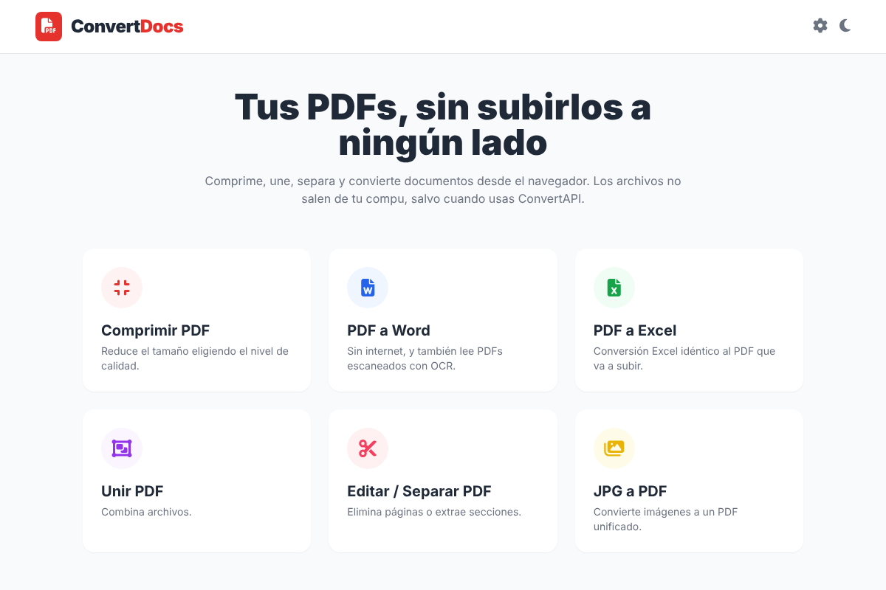
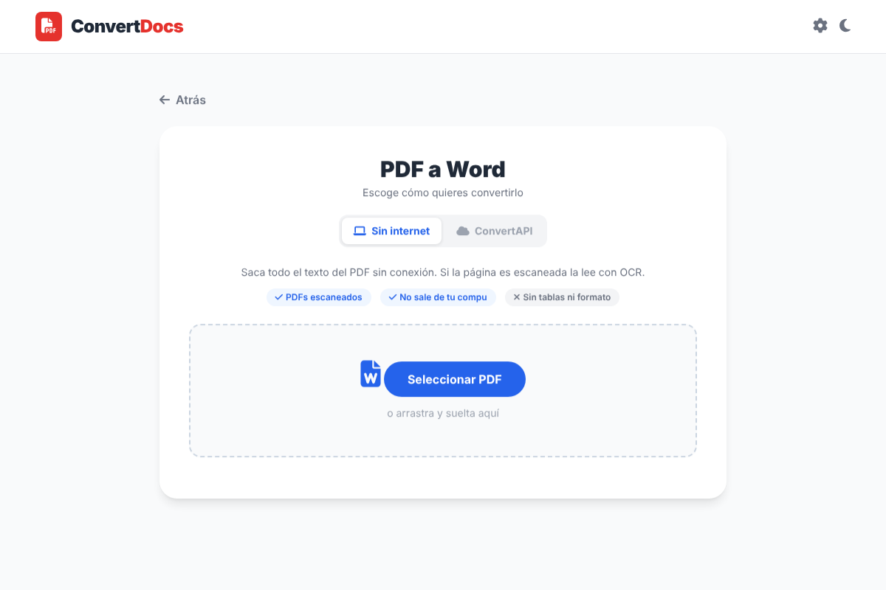

# ConvertDocs

Herramientas para PDFs que corren en el navegador. Las hice porque en la oficina siempre había que andar subiendo documentos a páginas de internet para unirlos, comprimirlos o pasarlos a Word, y no todos esos documentos deberían salir de la compu.

Casi todo funciona **sin internet**: el procesamiento pasa en el navegador y los archivos no se suben a ningún lado.



## Qué hace

| Herramienta | Sin internet | Cómo |
|---|---|---|
| Comprimir PDF | Sí | Vuelve a dibujar cada página como imagen más liviana. Tiene tres niveles. |
| PDF a Word | Sí | Saca el texto con pdf.js. Si la página es escaneada, la lee con OCR. |
| PDF a Word con formato | No | Usa ConvertAPI y respeta tablas, imágenes y colores. |
| PDF a Excel | No | Usa ConvertAPI. |
| Unir PDF | Sí | Se arrastran las miniaturas para escoger el orden. |
| Editar / separar PDF | Sí | Se escogen las páginas que se quedan o las que se van. |
| JPG / PNG a PDF | Sí | Cada imagen queda como una página. |

### PDF a Word sin internet



- Si la página trae texto, se saca directo y se arman los párrafos según la posición de cada renglón.
- Si la página es una foto o un escaneo, se le pasa OCR en español con Tesseract.
- El `.docx` se arma en el navegador, sin librerías.
- No copia tablas ni formato. Para eso está el modo ConvertAPI.

La primera vez que se usa el OCR tarda unos segundos más, porque tiene que cargar el motor y el modelo de español (unos 5 MB).

## Cómo correrlo

Tiene que abrirse desde un servidor, no con doble clic al `index.html`, porque el OCR corre en un Web Worker y el navegador no los deja correr desde `file://`.

**Con XAMPP**

1. Copia la carpeta a `C:\xampp\htdocs\convertdocs`.
2. Abre `http://localhost/convertdocs`.

**En un servidor sin internet**

Se copia la carpeta tal cual. Todas las librerías vienen en `vendor/`, así que no pide nada de afuera.

**Para probar rápido**

```bash
python -m http.server 8000
```

## Clave de ConvertAPI

Solo hace falta para PDF a Word con formato y para PDF a Excel.

- Se pone desde el engrane de arriba y se guarda en el navegador.
- Si quieres que ya venga puesta en un servidor, copia `config.example.js` como `config.local.js` y pon la clave ahí. Ese archivo está en el `.gitignore`.

La clave nunca va en el código.

## Cómo está armado

```
index.html          todas las pantallas
css/
  estilos.css       estilos propios
  tailwind.css      tailwind ya generado
js/
  app.js            navegación, toasts, clave de la API
  comprimir.js
  convertapi.js     pdf a word y excel con la API
  word-local.js     pdf a word sin internet
  ocr-worker.js     el ocr, corre aparte para no congelar la página
  docx.js           arma el .docx
  unir.js
  separar.js
  imagenes.js
vendor/             librerías locales
```

Cada herramienta se registra sola en `app` con `Object.assign`, así que para agregar una nueva basta con un archivo en `js/` y su `<script>` en el `index.html`.

### Si cambias clases de Tailwind

El CSS ya va generado. Si agregas clases nuevas en el HTML o en los JS, hay que regenerarlo:

```bash
npx tailwindcss -i css/tailwind.src.css -o css/tailwind.css --minify
```

## Librerías

Todas van en `vendor/` para que funcione sin conexión.

- [pdf.js](https://github.com/mozilla/pdf.js) 3.11.174, para leer y dibujar PDFs
- [pdf-lib](https://github.com/Hopding/pdf-lib), para unir, separar y crear PDFs
- [jsPDF](https://github.com/parallax/jsPDF) 2.5.1, para comprimir
- [tesseract.js-core](https://github.com/naptha/tesseract.js-core) y el modelo `spa` de [tessdata](https://github.com/naptha/tessdata), para el OCR
- [Tailwind CSS](https://tailwindcss.com), [Font Awesome](https://fontawesome.com) y [Animate.css](https://animate.style)

---

Hecho por [Said Ojeda](https://github.com/Said1Ojeda).
